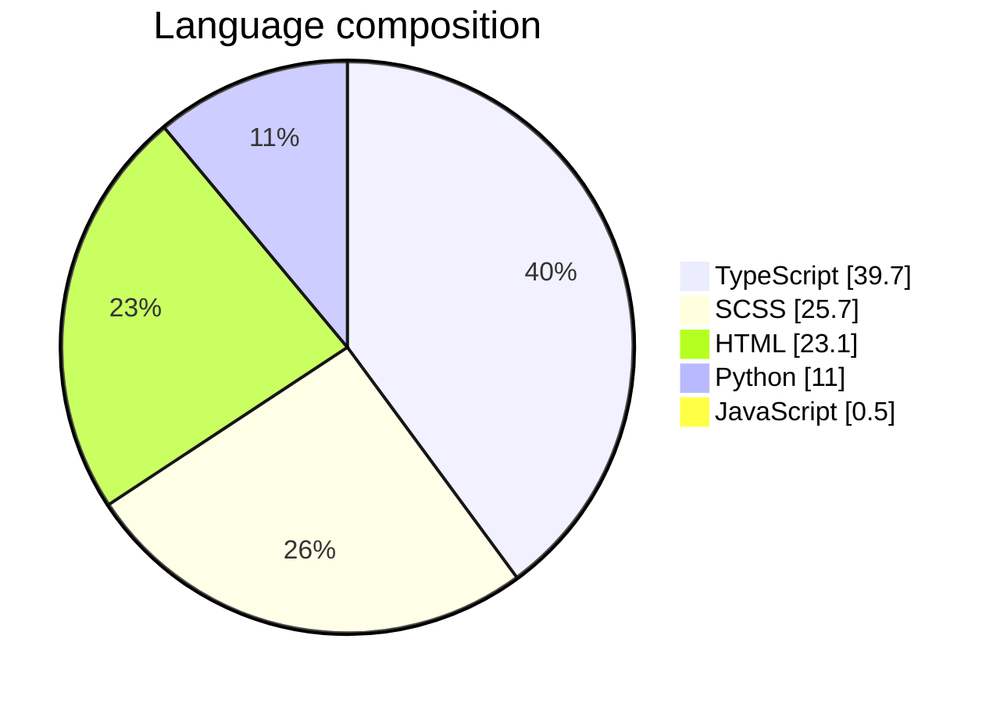

<div align="center">

# 🛍️ E-Commerce Storefront

### A mobile-friendly online shop for discovering products, managing a cart, and placing orders.

Built with **Ionic + Angular**, **FastAPI**, and **MariaDB/MySQL**.

[✨ Features](#-features) · [🧰 Tech stack](#-tech-stack) · [🚀 Run locally](#-run-locally) · [🔌 API](#-api-overview)

</div>

---

## 🌟 About the project

E-Commerce Storefront is a full-stack shopping application with customer and admin experiences. Customers can browse approved products, create an account, manage their cart, and place or cancel pending orders. Admins can manage the product catalog and review and update orders.

> 📌 **Checkout creates an order with `Pending` status.** The application does not process payments.

## ✨ Features

### 🛒 Customer storefront
- Browse approved products and search or filter by category
- Sign up, log in, and manage account details
- Add products to a cart, update quantities, and remove items
- Check out selected cart items or the whole cart
- View order history and cancel orders that are still pending

### 🧑‍💼 Admin tools
- Admin sign-in
- Create, update, and archive products
- View orders and change pending orders to approved or cancelled

### 📱 Application experience
- Responsive Ionic interface for mobile-friendly shopping
- FastAPI backend with interactive API documentation
- MariaDB/MySQL database schema and sample data included

## 🧰 Tech stack

| Area | Technologies |
| --- | --- |
| Frontend | Angular 22, Ionic 9, TypeScript, SCSS, Capacitor |
| Backend | Python, FastAPI, Uvicorn, Pydantic, bcrypt |
| Database | MariaDB / MySQL |

### 📊 Repository languages



## 🗂️ Project structure

```text
.
├── backend/
│   └── backend.py             # FastAPI app, database access, and API routes
├── ecommerce_db.sql          # Database schema and sample data
└── frontend/
    ├── package.json           # Frontend dependencies and npm scripts
    └── src/app/
        ├── auth/              # Customer sign-in and sign-up
        ├── services/          # Shared API client
        └── shop/
            ├── home/          # Featured products
            ├── search/        # Product search and category filters
            ├── cart/          # Cart management
            ├── account/       # Profile and logout
            └── tab/           # Store navigation
```

## 🚀 Run locally

### Prerequisites

- Python 3 and `pip`
- Node.js and `npm` (required by the Ionic/Angular tooling)
- Ionic CLI
- A running MariaDB or MySQL server

### 1. Set up the database 🗄️

From the repository root, create the database and import the included schema and sample data:

```bash
mysql -u root -p -e "CREATE DATABASE ecommerce_db;"
mysql -u root -p ecommerce_db < ecommerce_db.sql
```

If `ecommerce_db` already exists, skip the creation command.

### 2. Install and start the backend 🐍

From the repository root:

```bash
python3 -m venv .venv
source .venv/bin/activate
pip install fastapi uvicorn mysql-connector-python bcrypt
uvicorn backend.backend:backend_data --reload
```

The API runs at **http://127.0.0.1:8000**. Open **http://127.0.0.1:8000/docs** for interactive FastAPI documentation.

The database connection settings are currently defined in `backend/backend.py` (default: host `localhost`, user `root`, empty password, database `ecommerce_db`). Update them to match your local MySQL/MariaDB configuration.

### 3. Start the Ionic app with `ionic serve` 📱

Install the Ionic CLI if it is not already installed, then install the frontend dependencies and serve the app:

```bash
npm install -g @ionic/cli
cd frontend
npm install
ionic serve
```

`ionic serve` starts the app in the browser and watches for frontend changes. The API base URL is currently set to `http://127.0.0.1:8000` in `frontend/src/app/services/api.ts`.

### 🧪 Additional frontend commands

Run these from `frontend/`:

| Command | Description |
| --- | --- |
| `npm run build` | Build the frontend |
| `npm test` | Run frontend tests |
| `npm run lint` | Lint the frontend |

## 🔌 API overview

| Method | Route | Description |
| --- | --- | --- |
| `GET` | `/items` | List approved products |
| `POST` | `/signup` | Create a customer account |
| `POST` | `/login` | Authenticate a customer |
| `GET` / `PUT` | `/accounts/{user_id}` | Retrieve or update a profile |
| `GET` | `/cart/{user_id}` | Retrieve a customer's cart |
| `POST` | `/cart` | Add a product to a cart |
| `PUT` | `/cart/{cart_item_id}` | Update cart quantity |
| `DELETE` | `/cart/{cart_item_id}` | Remove a cart item |
| `POST` | `/orders` | Place an order from cart items |
| `GET` | `/orders/{user_id}` | List a customer's orders |
| `PUT` | `/orders/{order_id}/cancel` | Cancel a pending customer order |
| `POST` | `/admin/login` | Authenticate an admin |
| `GET` / `POST` | `/admin/items`, `/items` | List or create products (admin) |
| `PUT` / `DELETE` | `/items/{item_id}` | Update or archive/delete a product (admin) |
| `GET` | `/admin/orders` | List orders (admin) |
| `PUT` | `/admin/orders/{order_id}/status` | Update a pending order (admin) |

For request and response schemas, see the interactive docs at **http://127.0.0.1:8000/docs** after starting the backend.

## ⚠️ Development notes

- Configure database credentials and the frontend API URL for your environment before running the app.
- The backend currently allows CORS requests from all origins; restrict this before deploying publicly.
- No backend dependency lockfile or `requirements.txt` is included yet; the install command above lists the required packages.
- The project does not include payment processing.

---

<div align="center">

Made with ☕, code, and a little bit of 🛍️

</div>
